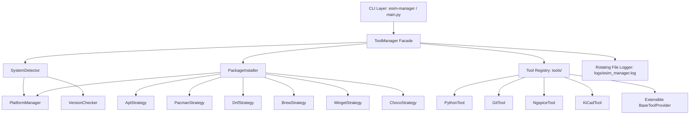
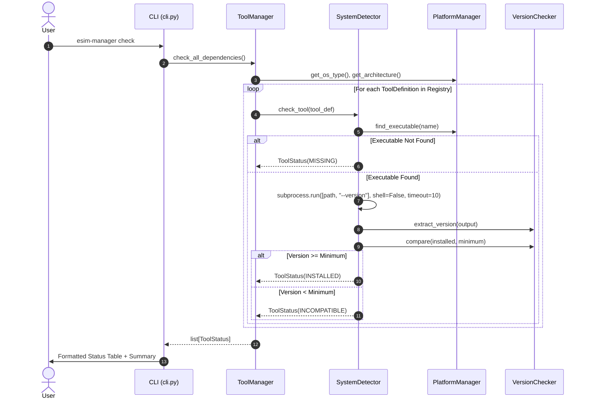
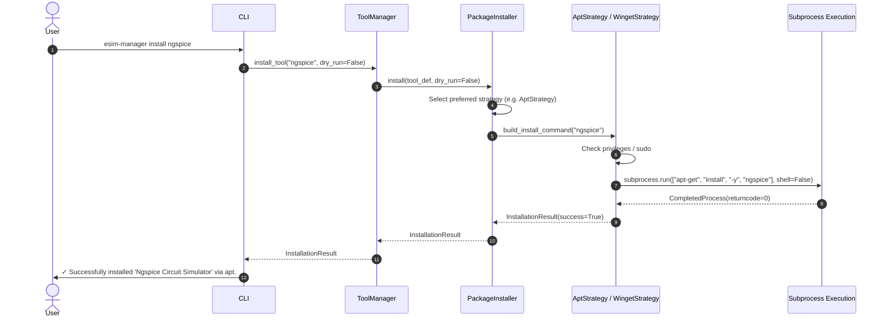

# eSim Automated Tool Manager — Detailed Design Document

**Project:** FOSSEE eSim Semester Long Internship Screening Task  
**Task:** Task 5 — Tool Manager (CSE and Related Fields)  
**Target Architecture:** Python 3.10+ Standard Library Architecture with Zero-Unnecessary Dependencies  
**Version:** 1.0.0  
**Author:** Candidate (eSim Open Source Contributor)

---

## 1. Executive Summary & Problem Statement

eSim is an open-source Electronic Design Automation (EDA) suite developed by FOSSEE, IIT Bombay. eSim integrates numerous standalone open-source engineering tools, including:
- **Ngspice**: SPICE simulation engine for analog/mixed-signal netlists.
- **KiCad EDA**: Schematic capture (`eeschema`) and PCB layout (`pcbnew`).
- **Python**: Core interpreter and subcircuit scripting runtime.
- **Git**: Distributed model repository and schematic version control.

### The Challenge
Installing and orchestrating these heterogeneous external tools across disparate operating systems (Debian/Ubuntu, Arch, Fedora, Windows, macOS) presents recurring friction:
1. Version mismatch (e.g. Ngspice < 38 causing model syntax incompatibilities; KiCad 5 vs KiCad 7/8 schematic schema divergences).
2. Binary path discrepancies across environments (e.g. `/usr/bin/ngspice`, `/usr/local/bin/ngspice`, `C:\Program Files\KiCad\...`).
3. Platform-specific installer fragmentation (APT on Ubuntu, Winget/Choco on Windows, Homebrew on macOS, Pacman on Arch).
4. Silent failures and lack of structured logging during automated setups.

### The Solution
The **Automated Tool Manager** provides a robust, cross-platform, modular Python engine that:
- Completely implements **Requirement 1: Tool Installation Management**.
- Completely implements **Requirement 4: Dependency Checker**.
- Provides semantic version extraction and comparison.
- Implements comprehensive diagnostics (`doctor`), actionable guidance, rotating file logging, and an intuitive CLI supporting human-readable and machine-readable JSON outputs.

---

## 2. High-Level Architecture & Component Decomposition

The system is built on SOLID engineering principles, leveraging the **Strategy Pattern** for package managers, the **Registry Pattern** for tool definitions, and a unified **Facade Pattern** via `ToolManager`.



---

## 3. Core Modules & Responsibilities

### 3.1 `esim_tool_manager.models`
Defines strictly typed dataclasses and enumerations:
- `StatusEnum`: Enum representing tool states:
  - `INSTALLED`: Binary exists and satisfies version requirements.
  - `MISSING`: Binary is not located on PATH or search paths.
  - `INCOMPATIBLE`: Binary exists, but installed version is lower than `minimum_version`.
  - `UNKNOWN`: Binary located, but version string could not be extracted or timed out.
  - `UNSUPPORTED`: Tool does not support host platform.
- `SystemInfo`: Captures OS type, release version, processor architecture, Python version, elevation status (`is_admin`), and detected package managers.
- `ToolDefinition`: Specification of an external EDA tool including executables, alternate binaries, min version, regex, package mappings, docs URL, and custom extractors.
- `ToolStatus`: Snapshot of tool state on the machine.
- `InstallationResult`: Detailed outcome of an installation attempt (success flag, command array, exit code, stdout, stderr, dry-run indicator).

### 3.2 `esim_tool_manager.platform` (`PlatformManager`)
Encapsulates all platform-specific heuristics:
- **OS & Distro Detection**: Utilizes `platform.freedesktop_os_release()` (Python 3.10+) with fallback to `/etc/os-release`, `platform.win32_ver()`, and `platform.mac_ver()`.
- **Privilege Checking**: Inspects `os.geteuid() == 0` on POSIX and `ctypes.windll.shell32.IsUserAnAdmin()` on Windows.
- **Binary Discovery**: Resolves executables across `shutil.which` and custom directory paths, appending `.exe` on Windows automatically.

### 3.3 `esim_tool_manager.version_checker` (`VersionChecker`)
Handles version extraction and comparison:
- **Banner Parsing**: Extracts numeric semantic versions from varied outputs (e.g. `Python 3.10.12`, `git version 2.34.1`, `** ngspice-42.2 : Circuit level simulation program`, `Application: kicad Version: 7.0.10`).
- **Numeric Tuple Transformation**: Converts strings like `"42.2"` to `(42, 2, 0)` and `"7.0.1-0"` to `(7, 0, 1, 0)`.
- **SemVer Comparison**: Performs tuple-based comparative logic (`installed >= required`).

### 3.4 `esim_tool_manager.detector` (`SystemDetector`)
- Probes system environment and enumerates installed package managers (`apt`, `pacman`, `dnf`, `brew`, `winget`, `choco`).
- Safely probes external tools using non-shell subprocess execution with strict timeouts (10s) and exception handling (`subprocess.TimeoutExpired`, `PermissionError`, `OSError`).

### 3.5 `esim_tool_manager.installer` (`PackageInstaller` & Strategies)
Implements the **Strategy Pattern** for cross-platform package management:
- **Strategies**: `AptStrategy`, `PacmanStrategy`, `DnfStrategy`, `BrewStrategy`, `WingetStrategy`, `ChocoStrategy`.
- **Privilege Elevation Handling**: Checks if a strategy requires root/administrator privileges; if standard user on Linux, automatically checks for `sudo` availability or returns a clear actionable failure message instead of crashing.
- **Dry-Run Mode (`--dry-run`)**: Accurately simulates the exact argument array and logs the command without executing side effects on the host.
- **Security**: Strict prevention of arbitrary command execution. Arguments are always passed as arrays (`subprocess.run(cmd, shell=False)`).

### 3.6 `esim_tool_manager.tools` (Tool Registry)
- Centralized registry exposing `get_all_tools()`, `get_tool(name)`, `register_tool(tool)`.
- Core definitions: `PythonTool`, `GitTool`, `NgspiceTool`, `KiCadTool`.
- Case-insensitive retrieval and alias resolution (e.g. `kicad-cli`, `python3.10`).

### 3.7 `esim_tool_manager.logger`
- Rotating file logging to `logs/esim_manager.log` (5 MB max per file, 3 backups).
- Tracks all operations, commands, detected versions, and error stacks.

---

## 4. Execution Workflows

### 4.1 Dependency Check Workflow (`esim-manager check`)



### 4.2 Installation Workflow (`esim-manager install ngspice`)



---

## 5. Extensibility: Adding a New Tool

Adding support for any new external EDA tool (e.g., **Verilator**, **GHDL**, or **OpenFOAM**) requires only creating a single provider class:

```python
from esim_tool_manager.models import ToolDefinition
from esim_tool_manager.tools.base import BaseToolProvider
from esim_tool_manager.tools import register_tool

class VerilatorTool(BaseToolProvider):
    def get_definition(self) -> ToolDefinition:
        return ToolDefinition(
            name="verilator",
            display_name="Verilator HDL Simulator",
            description="Fast open-source Verilog/SystemVerilog simulator.",
            executable="verilator",
            minimum_version="5.0.0",
            version_command=["--version"],
            version_regex=r"Verilator\s+(\d+(?:\.\d+)+)",
            package_names={
                "apt": "verilator",
                "brew": "verilator",
                "pacman": "verilator",
                "dnf": "verilator",
                "winget": "Verilator.Verilator",
            },
            supported_platforms=["linux", "windows", "darwin"],
            category="HDL Simulation",
            docs_url="https://verilator.org",
        )

# Register into the manager
register_tool(VerilatorTool())
```
No modification of core detection, logging, or CLI logic is needed!

---

## 6. Security Analysis & Hardening

1. **No Arbitrary Shell Invocations**:
   - `shell=True` is strictly prohibited throughout the entire codebase.
   - All external processes are invoked via explicit argument lists: `subprocess.run(["apt-get", "install", "-y", pkg], shell=False)`.
2. **Input Validation**:
   - Tool names are validated against the tool registry; unrecognized names raise `ToolNotFoundError` before reaching any subprocess handler.
3. **Privilege Elevation Safeguards**:
   - Tool checking and diagnostics (`check`, `list`, `doctor`, `version`, `info`) require **zero** administrative permissions.
   - Privilege requirements are only triggered on actual installation (`install`), where explicit confirmation or `--dry-run` is respected.
4. **Credential Isolation**:
   - The logging subsystem never logs environment secrets or passwords.
